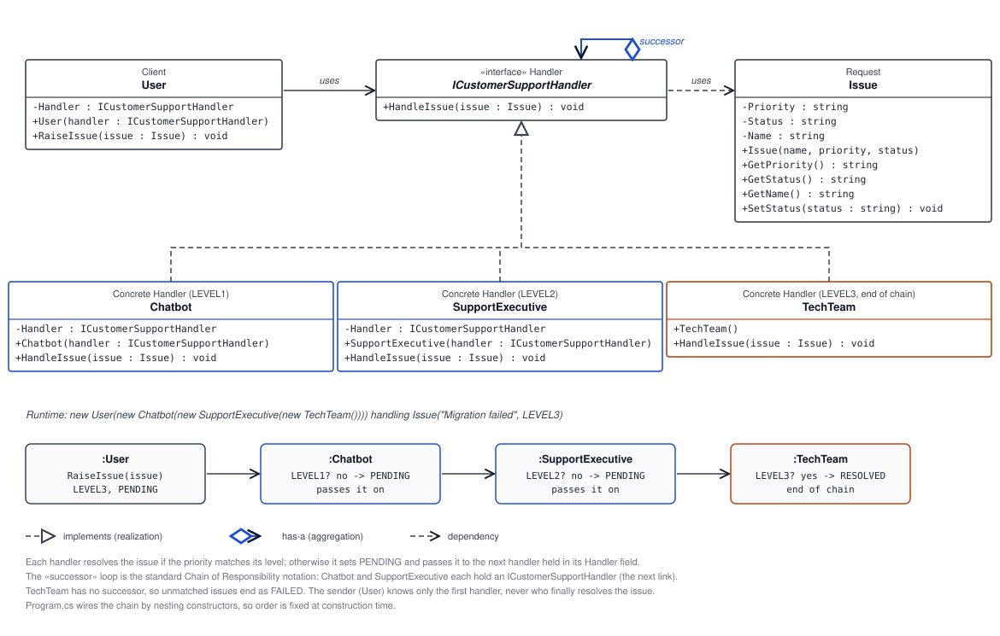

# 🔗 Chain of Responsibility

## 💡 What is the Chain of Responsibility pattern?

Chain of Responsibility is a behavioral design pattern that passes a request through a sequence of potential handlers. Each handler decides whether it can process the request. If it can, it handles the request; otherwise, it passes the request to the next handler. The sender only needs to know the first handler in the chain, not which handler will ultimately process the request.

## ✅ Does this implementation use the pattern?

Yes. The example has a common handler interface, multiple concrete handlers, and successor references that let a request move through the chain. `User` starts the request at the first handler, while each handler is responsible for matching its own priority level or forwarding the issue.

The chain is assembled in `Program.cs` as:

```csharp
User user = new User(new Chatbot(new SupportExecutive(new TechTeam())));
user.RaiseIssue(new Issue("Migration failed", "LEVEL3", "PENDING"));
```

This makes the order explicit and fixed when the chain is constructed: `Chatbot` → `SupportExecutive` → `TechTeam`.

## 📐 UML diagram



The diagram shows the handler relationship and an example `LEVEL3` issue moving through the chain until `TechTeam` resolves it.

## ⚙️ How this example works

- 🧩 **`ICustomerSupportHandler`** defines the shared `HandleIssue(Issue issue)` operation for every handler.
- 🤖 **`Chatbot`** handles `LEVEL1` issues. For any other priority, it marks the issue `PENDING` and forwards it to its configured handler.
- 🧑‍💼 **`SupportExecutive`** handles `LEVEL2` issues. Otherwise, it marks the issue `PENDING` and forwards it to the tech team.
- 🛠️ **`TechTeam`** handles `LEVEL3` issues. It is the end of this chain; if the priority is not `LEVEL3`, it marks the issue `FAILED`.
- 👤 **`User`** is the client. It knows only the first handler and submits issues through `RaiseIssue`.
- 📋 **`Issue`** carries the issue name, priority, and status through the chain. Handlers update its status as they process it.

### 🎯 Supported priorities

| Priority | Handler that resolves it | Processing |
|---|---|---|
| `LEVEL1` | 🤖 `Chatbot` | ✅ Resolved immediately |
| `LEVEL2` | 🧑‍💼 `SupportExecutive` | ➡️ Passed by `Chatbot`, then resolved |
| `LEVEL3` | 🛠️ `TechTeam` | ➡️ Passed through both earlier handlers, then resolved |
| Any other value | — | ❌ Reaches `TechTeam` and ends as `FAILED` |

⚠️ Priority values are strings and must match exactly. The chain's order is determined by the nested constructors in `Program.cs`.

## 🌟 Benefits

- 🔌 **Reduces sender/handler coupling:** The client submits to the first handler without depending on the concrete handler that will resolve the request.
- 🧭 **Separates responsibilities:** Each handler contains the logic for its own kind of issue.
- ➕ **Makes routing easy to extend:** A new handler can be added to the chain without putting all routing decisions in the client.
- 🔄 **Supports flexible chains:** Successor links can be changed when constructing the chain to use a different order or set of handlers.

## 🌍 Real-life example

A customer-support request can pass through an automated chatbot 🤖, a support representative 🧑‍💼, and then a specialist engineering team 🛠️. The chatbot resolves common questions; unresolved requests go to the representative; issues requiring technical expertise are forwarded to engineering. The customer starts one request without needing to know which team will eventually handle it.

This example models that workflow with priority levels: `Chatbot` handles `LEVEL1`, `SupportExecutive` handles `LEVEL2`, and `TechTeam` handles `LEVEL3`.
