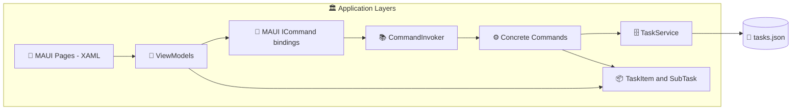
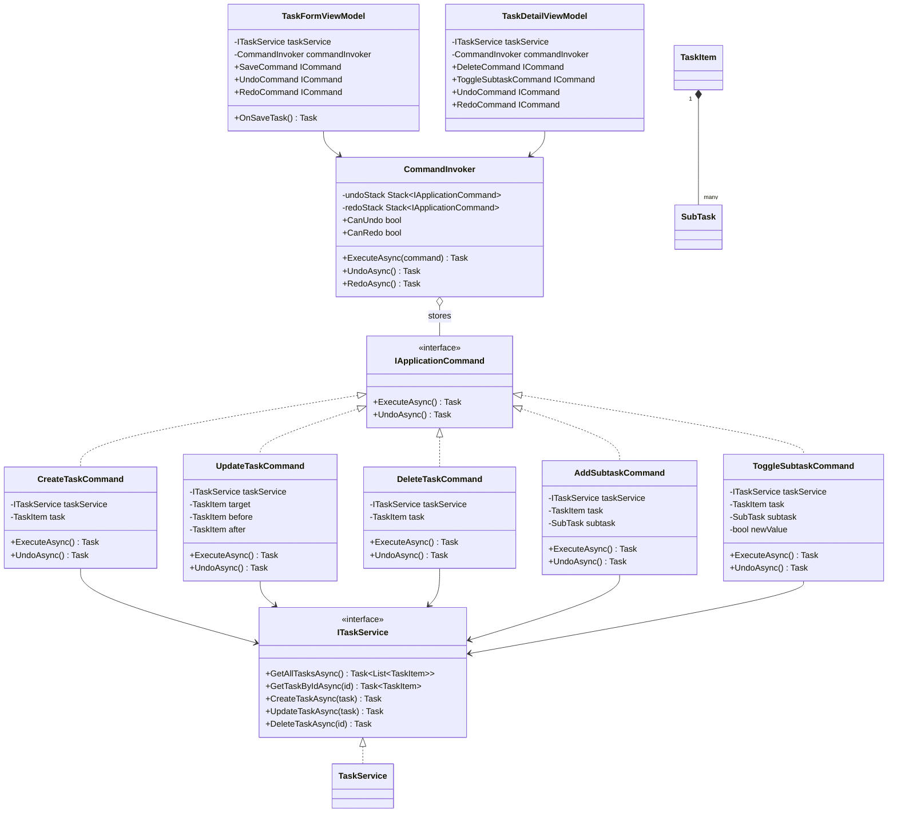
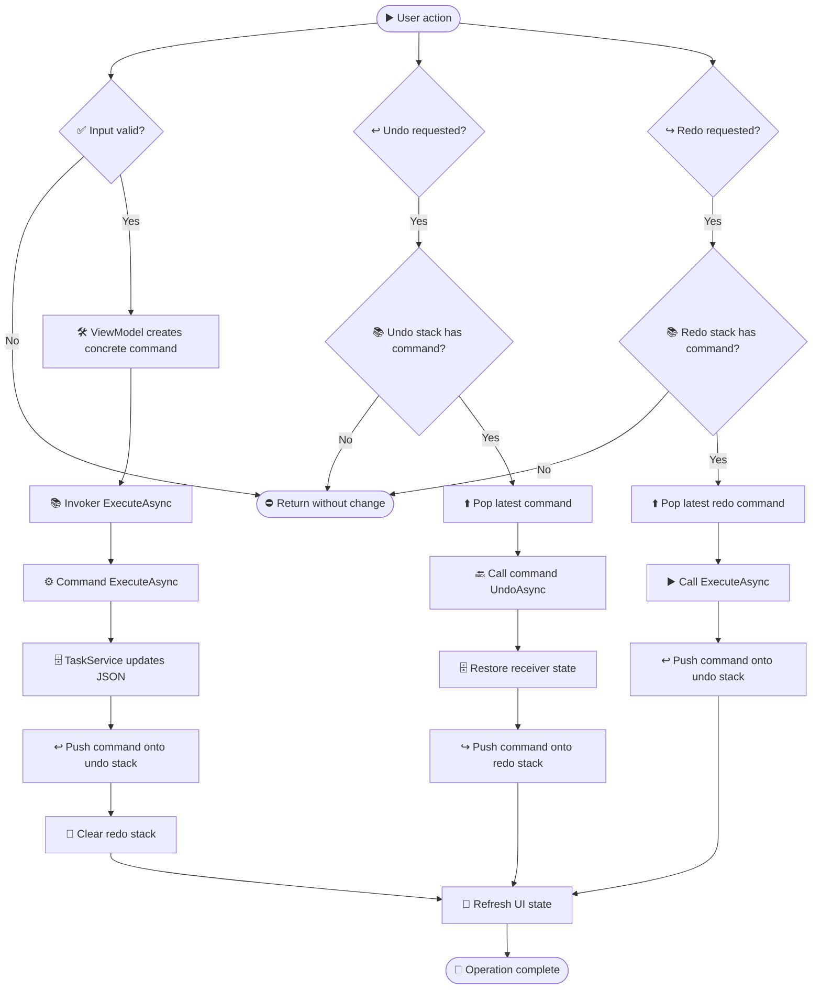

# ✅ To-Do List — Command Pattern Example

An .NET MAUI task-management application that demonstrates the **Command behavioral design pattern** alongside the **MVVM architectural pattern**.

## 🧭 Table of Contents

- [🎯 Overview](#-overview)
- [🏗️ Design Architecture](#️-design-architecture)
- [🧩 Command Pattern Mapping](#-command-pattern-mapping)
- [🗺️ Class Diagram](#️-class-diagram)
- [🔄 Flow Chart](#-flow-chart)
- [📝 Pseudocode](#-pseudocode)
- [📁 Project Structure](#-project-structure)
- [✨ Features](#-features)
- [▶️ Run the Project](#️-run-the-project)

## 🎯 Overview

The application supports creating, viewing, editing, deleting, and completing tasks and subtasks. The main architectural goal is to separate responsibilities:

- **📱 View / XAML:** Displays controls and binds UI actions to commands.
- **🧠 ViewModel:** Handles navigation and client-side use cases.
- **⚙️ Command:** Encapsulates a request as an executable and reversible object.
- **📚 Invoker:** Executes commands and maintains undo/redo history.
- **🗄️ Receiver / Service:** Performs JSON-file persistence.
- **📦 Model:** Represents tasks and subtasks.

## 🏗️ Design Architecture



### 🧱 Architectural Responsibilities

| Icon | Layer | Responsibility |
|---|---|---|
| 📱 | **View** | XAML pages and controls |
| 🔗 | **Command Binding** | Connects MAUI buttons and checkboxes to `ICommand` |
| 🧠 | **ViewModel** | Creates commands and exposes state |
| ⚙️ | **Concrete Command** | Captures receiver, arguments, execute, and undo logic |
| 📚 | **Invoker** | Runs commands and manages undo/redo stacks |
| 🗄️ | **Receiver** | Reads and writes tasks in JSON storage |
| 📦 | **Domain Model** | Stores task and subtask data |

The application follows **MVVM** for UI separation and **Command Pattern** for operations that can be executed and reversed.

## 🧩 Command Pattern Mapping

| Pattern Role | Project Component | Purpose |
|---|---|---|
| 🧾 **Command** | [`IApplicationCommand`](/Users/yashnagi/Projects/Design%20Patterns/design-patterns-tutorials/Behavioral-Design-Patterns/CommandPattern/to-do-list/Interfaces/IApplicationCommand.cs) | Defines `ExecuteAsync` and `UndoAsync` |
| 🛠️ **Concrete Commands** | [`Commands/`](/Users/yashnagi/Projects/Design%20Patterns/design-patterns-tutorials/Behavioral-Design-Patterns/CommandPattern/to-do-list/Commands/) | Implement task and subtask operations |
| 🎮 **Invoker** | [`CommandInvoker`](/Users/yashnagi/Projects/Design%20Patterns/design-patterns-tutorials/Behavioral-Design-Patterns/CommandPattern/to-do-list/Services/CommandInvoker.cs) | Executes commands and maintains undo/redo stacks |
| 🗃️ **Receiver** | [`TaskService`](/Users/yashnagi/Projects/Design%20Patterns/design-patterns-tutorials/Behavioral-Design-Patterns/CommandPattern/to-do-list/Services/TaskService.cs) | Reads and writes the task collection |
| 👤 **Client** | [`ViewModels/`](/Users/yashnagi/Projects/Design%20Patterns/design-patterns-tutorials/Behavioral-Design-Patterns/CommandPattern/to-do-list/ViewModels/) | Creates commands and invokes behavior |

Concrete command implementations:

- ➕ [`CreateTaskCommand`](/Users/yashnagi/Projects/Design%20Patterns/design-patterns-tutorials/Behavioral-Design-Patterns/CommandPattern/to-do-list/Commands/CreateTaskCommand.cs)
- ✏️ [`UpdateTaskCommand`](/Users/yashnagi/Projects/Design%20Patterns/design-patterns-tutorials/Behavioral-Design-Patterns/CommandPattern/to-do-list/Commands/UpdateTaskCommand.cs)
- 🗑️ [`DeleteTaskCommand`](/Users/yashnagi/Projects/Design%20Patterns/design-patterns-tutorials/Behavioral-Design-Patterns/CommandPattern/to-do-list/Commands/DeleteTaskCommand.cs)
- 📋 [`AddSubtaskCommand`](/Users/yashnagi/Projects/Design%20Patterns/design-patterns-tutorials/Behavioral-Design-Patterns/CommandPattern/to-do-list/Commands/AddSubtaskCommand.cs)
- ☑️ [`ToggleSubtaskCommand`](/Users/yashnagi/Projects/Design%20Patterns/design-patterns-tutorials/Behavioral-Design-Patterns/CommandPattern/to-do-list/Commands/ToggleSubtaskCommand.cs)

## 🗺️ Class Diagram



## 🔄 Flow Chart



## 📝 Pseudocode

### 💾 Execute a command

```text
PROCEDURE ExecuteAsync(command):
    command.ExecuteAsync()

    IF execution succeeds:
        undoStack.Push(command)
        redoStack.Clear()
    ELSE:
        Show error
        Keep existing stacks unchanged
END PROCEDURE
```

### ↩️ Undo

```text
PROCEDURE UndoAsync():
    IF undoStack is empty:
        RETURN

    command = undoStack.Pop()
    command.UndoAsync()
    redoStack.Push(command)
    Refresh UI
END PROCEDURE
```

### ↪️ Redo

```text
PROCEDURE RedoAsync():
    IF redoStack is empty:
        RETURN

    command = redoStack.Pop()
    command.ExecuteAsync()
    undoStack.Push(command)
    Refresh UI
END PROCEDURE
```

### ✏️ Update task

```text
PROCEDURE SaveUpdatedTask(viewModel):
    IF title is blank:
        RETURN

    before = snapshot of original task
    after = snapshot of edited task
    command = UpdateTaskCommand(taskService, target, before, after)
    ExecuteAsync(command)
    Navigate back
END PROCEDURE

PROCEDURE UpdateTaskCommand.ExecuteAsync():
    Copy all fields from after snapshot to target
    taskService.UpdateTaskAsync(target)
END PROCEDURE

PROCEDURE UpdateTaskCommand.UndoAsync():
    Copy all fields from before snapshot to target
    taskService.UpdateTaskAsync(target)
END PROCEDURE
```

## 📁 Project Structure

```text
to-do-list/
├── Commands/                    # ⚙️ Concrete command objects
├── Converters/                  # 🎨 XAML value converters
├── Interfaces/                  # 🔌 ITaskService and IApplicationCommand
├── Models/                      # 📦 TaskItem and SubTask
├── Pages/                       # 📱 MAUI XAML pages
├── Services/                    # 🗄️ Persistence and CommandInvoker
├── ViewModels/                  # 🧠 MVVM client logic
├── Platforms/                   # 📲 Platform-specific setup
├── Resources/                   # 🖼️ Icons, fonts, and styles
├── MauiProgram.cs               # 🚀 Dependency registration
└── README.md                    # 📖 This documentation
```

## ✨ Features

- ➕ Create tasks
- ✏️ Edit tasks
- 🗑️ Delete tasks with confirmation
- 📋 Add subtasks
- ☑️ Toggle subtask completion
- ↩️ Undo operations
- ↪️ Redo operations
- 📊 Display task and subtask progress
- 💾 Persist tasks in JSON storage
- 🔗 Bind UI actions through MAUI `ICommand`

## ▶️ Run the Project

From the repository root:

```bash
cd "design-patterns-tutorials/Behavioral-Design-Patterns/CommandPattern/to-do-list"
dotnet restore
dotnet build
dotnet build -t:Run -f net10.0-maccatalyst
```

The exact run framework depends on the installed .NET MAUI workloads and the target platform.
