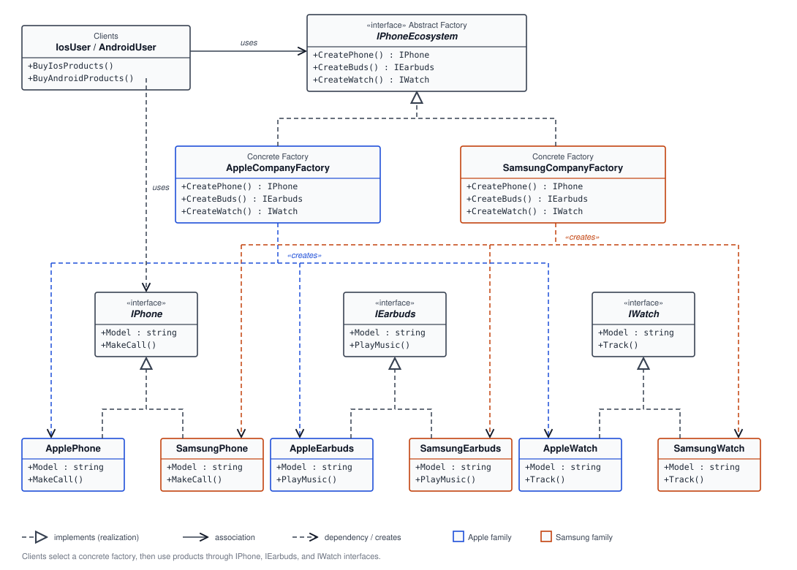

# 🏭 Abstract Factory: Device Ecosystems

## 🧩 What Is Abstract Factory?

The **Abstract Factory** pattern provides an interface for creating families of related objects without requiring client code to construct concrete classes directly. A client selects a factory for a product family, then creates the family’s products through a shared set of factory methods.

This example models two device ecosystems: Apple and Samsung. Each ecosystem factory creates a phone, earbuds, and a watch that belong to the same brand family.

## ⚙️ How This Example Works

- `IPhoneEcosystem` is the abstract factory interface. It declares `CreatePhone()`, `CreateBuds()`, and `CreateWatch()`.
- `IPhone`, `IEarbuds`, and `IWatch` are abstract product interfaces. They define each product’s model and behavior: calling, playing music, and tracking.
- `AppleCompanyFactory` creates `ApplePhone`, `AppleEarbuds`, and `AppleWatch`.
- `SamsungCompanyFactory` creates `SamsungPhone`, `SamsungEarbuds`, and `SamsungWatch`.
- `IosUser` chooses the Apple factory, and `AndroidUser` chooses the Samsung factory. Each client creates products through `IPhoneEcosystem` and uses them through the product interfaces.
- The concrete products print messages to the console to demonstrate their behavior.

## 📊 UML Class Diagram

The diagram shows the client classes, abstract factory and product interfaces, concrete factories, and the Apple and Samsung product implementations. The dashed realization arrows indicate interface implementations; the factory dependencies show which product family each concrete factory creates.

## 🤔 Why Use Abstract Factory?

When an application creates several products that are intended to work together, constructing each product independently can mix incompatible implementations. Abstract Factory groups the creation rules for a family behind one factory interface. The client can work with a consistent set of abstractions while the selected factory supplies the matching concrete products.

## ✨ Benefits

- 🔗 **Less coupling to products:** clients use `IPhone`, `IEarbuds`, and `IWatch` rather than constructing concrete product classes themselves.
- 🧺 **Consistent product families:** each factory returns products from its own ecosystem.
- 🔄 **Family-level switching:** changing the selected factory changes all product implementations together.
- 🧪 **Easier substitution:** implementations of the factory interface can be replaced in tests or application configuration.
- 🧱 **Centralized creation:** concrete construction rules live in the factories, not across the product-using logic.

## 🧭 Where to Implement It

Use Abstract Factory at a composition or configuration boundary, where the application decides which family of related objects it needs. The rest of the application can then receive the abstract factory and consume its abstract products without knowing their concrete types.

It is a good fit when:

- There are multiple families of related products.
- Products from different families should not be mixed.
- The application should switch a whole family as one unit, such as by platform, provider, theme, or deployment environment.

It may be unnecessary when there is only one product or one implementation. Adding a new product type also requires updating the factory interface and every concrete factory, so the pattern is most useful when family consistency is more important than minimizing factory changes.

## 🏠 Real-Life Example

Consider a cross-platform application that needs native controls for Windows and macOS. A `WindowsUiFactory` could create a Windows button, menu, and dialog, while a `MacUiFactory` creates the corresponding macOS controls. The application requests each control through abstract interfaces, and selecting a platform factory keeps the created controls consistent with that platform.

The device example uses the same idea: selecting Apple or Samsung supplies a matching phone, earbuds, and watch.

## ⚠️ Notes About This Implementation

- `IosUser` and `AndroidUser` instantiate their concrete factories directly. This keeps the tutorial simple, but the clients cannot choose a factory through configuration or dependency injection. Supplying `IPhoneEcosystem` to the clients would make that choice replaceable.
- The interface name `IPhoneEcosystem` is narrower than its responsibilities because it creates earbuds and watches as well as phones. A broader name such as `IDeviceEcosystemFactory` would describe both product families more clearly.
- The factory contract groups the related products, but the type system does not prevent a future factory implementation from returning a mismatched brand. Consistent family selection is currently enforced by each factory’s implementation.
