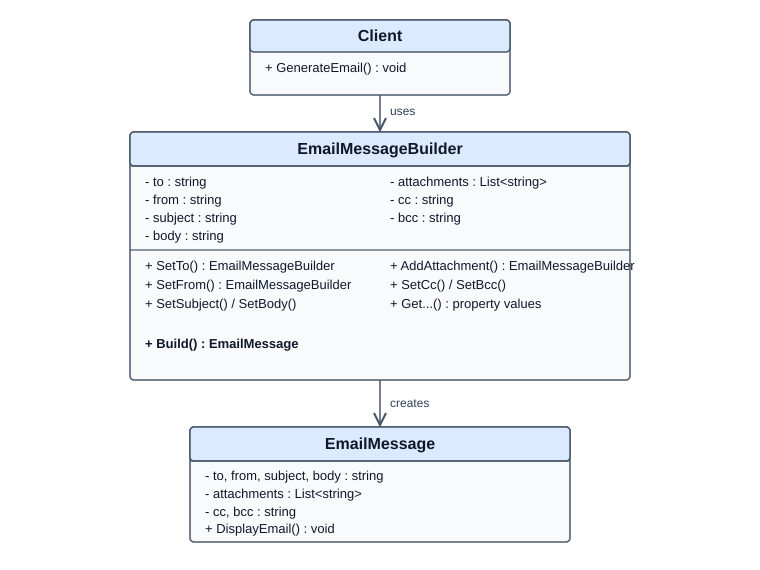

# Builder Design Pattern

## 📖 What Is the Builder Design Pattern?

The **Builder Design Pattern** is a creational design pattern that constructs complex objects step by step. It separates the process of constructing an object from the final representation of that object.

In simple words, the Builder pattern allows us to create an object by setting its properties through a sequence of method calls instead of passing many parameters to a constructor.

For example, an email message may contain a recipient, sender, subject, body, CC, BCC, and attachments. The Builder pattern lets us configure these properties gradually and create the final `EmailMessage` object when we call `Build()`.

## 🤔 Why Do We Need the Builder Pattern?

Imagine creating an email message using a constructor:

```csharp
var email = new EmailMessage(
    to,
    from,
    subject,
    body,
    attachments,
    cc,
    bcc);
```

As the number of properties grows, the constructor becomes harder to read and maintain. Optional parameters can also make object creation cumbersome.

The Builder pattern provides a more readable approach:

```csharp
var email = new EmailMessageBuilder()
    .SetTo("recipient@example.com")
    .SetFrom("sender@example.com")
    .SetSubject("Test Email")
    .SetBody("This is a test email.")
    .Build();
```

Each method clearly communicates which property is being configured, and `Build()` creates the final object.

## ✨ Benefits of the Builder Pattern

- **Improved Readability:** Method names make object construction self-explanatory.
- **Step-by-Step Construction:** Properties can be configured in multiple steps.
- **Optional Properties:** Optional values can be set only when needed.
- **Reduced Constructor Complexity:** Avoids constructors with many parameters.
- **Flexible Object Creation:** Different configurations can produce different objects of the same type.
- **Better Separation of Responsibilities:** The builder handles construction, while the product represents the completed object.

## 📍 Where Should We Implement the Builder Pattern?

The Builder pattern is useful when an object has multiple properties, optional values, or a construction process that would otherwise become complicated.

Common examples include:

- **Email Messages:** Configure recipients, subject, body, CC, BCC, and attachments.
- **HTTP Requests:** Configure headers, query parameters, content, and request options.
- **Database Queries:** Build queries by adding conditions, joins, and ordering.
- **Reports:** Configure titles, sections, filters, and output formats.
- **Complex Configuration Objects:** Assemble settings from multiple optional properties.
- **Test Data:** Construct objects with different combinations of values for unit tests.

Do not use the Builder pattern for every object. A simple object with only a few required properties may be easier to create using a normal constructor or object initializer.

## 🌍 Real-Life Example

Imagine ordering a customized pizza.

You choose the size, crust, sauce, cheese, and toppings. Once you finish selecting the ingredients, the order is prepared.

The builder represents the process of selecting and assembling the pizza, while the final pizza represents the completed product.

Similarly, in our example, `EmailMessageBuilder` configures the email, and `Build()` creates the final `EmailMessage` object.

## 💻 Understanding the C# Implementation

The implementation contains three classes:

1. `Client` — initiates the construction process.
2. `EmailMessageBuilder` — collects and configures email properties.
3. `EmailMessage` — represents the completed email object.

### 1. Client Class

```csharp
public class Client
{
    public void GenerateEmail()
    {
        var builder = new EmailMessageBuilder()
            .SetTo("recipient@example.com")
            .SetFrom("sender@example.com")
            .SetSubject("Test Email")
            .SetBody("This is a test email.")
            .Build();

        builder.DisplayEmail();
    }
}
```

**What happens here?**

- A new `EmailMessageBuilder` instance is created.
- `SetTo()`, `SetFrom()`, `SetSubject()`, and `SetBody()` configure the email.
- Each setter returns the builder instance, allowing the next method to be called immediately.
- `Build()` creates and returns the final `EmailMessage`.
- `DisplayEmail()` prints the message details.

This technique is called **method chaining** and makes the construction code concise and readable.

### 2. EmailMessageBuilder Class

The builder stores the values required to construct an email.

```csharp
private string to;
private string from;
private string subject;
private string body;
private List<string> attachments = new List<string>();
private string cc;
private string bcc;
```

These fields hold the email configuration while the object is being assembled.

#### Fluent setter methods

```csharp
public EmailMessageBuilder SetTo(string to)
{
    this.to = to;
    return this;
}
```

The method assigns the recipient address and returns `this`, which refers to the current builder instance.

The other methods follow the same approach. `AddAttachment()` adds an item to the attachment collection, while `SetCc()` and `SetBcc()` configure optional recipients.

#### The Build() method

```csharp
public EmailMessage Build()
{
    return new EmailMessage(builder: this);
}
```

This is the key method in the pattern. It passes the current builder to the `EmailMessage` constructor, which creates the final product.

In this implementation, the builder is also responsible for supplying the configured property values to the product.

### 3. EmailMessage Class

The `EmailMessage` class represents the completed email.

```csharp
public EmailMessage(EmailMessageBuilder builder)
{
    this.to = builder.GetTo();
    this.from = builder.GetFrom();
    this.subject = builder.GetSubject();
    this.body = builder.GetBody();
    this.attachments = builder.GetAttachments();
    this.cc = builder.GetCc();
    this.bcc = builder.GetBcc();
}
```

When the constructor receives the builder, it copies the configured values into the email object.

The getter methods expose these values, and `DisplayEmail()` prints the email details.

The `if` conditions ensure that attachments, CC, and BCC are displayed only when they contain values.

**Important implementation detail:** Although the email fields are `readonly`, the attachment list is still mutable. Also, `GetAttachments()` returns the same list held by the builder. If you want a more robust immutable product, copy the list during construction and expose it through a read-only collection.

## UML Diagram



## 🔄 Execution Flow

1. The client creates an `EmailMessageBuilder`.
2. The client configures the email properties through chained methods.
3. The builder retains the configured values.
4. The client calls `Build()`.
5. The builder creates an `EmailMessage`.
6. The completed email displays its details.

## 🧠 Key Takeaway

The Builder Design Pattern separates the process of constructing an object from the final object itself.

Use it when object creation involves many properties, optional configuration, or multiple construction steps.

**Remember:** The goal is not to add more classes. It is to make complex object creation easier to read, maintain, and extend.
