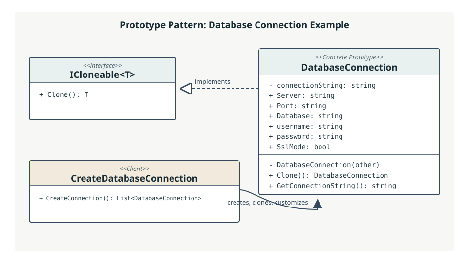

# 🧬 Prototype Pattern

The **Prototype** is a creational design pattern that creates new objects by copying an existing, configured object (the _prototype_) instead of constructing each object from scratch. A client asks the prototype to clone itself and can then customize the returned copy.

## 💡 Why Use It?

Prototype is useful when:

- Creating an object from scratch requires repeated setup or expensive initialization.
- Several objects share most of their initial state but need small per-instance differences.
- The code that requests an object should not need to know its concrete construction steps.
- The set of object configurations may vary at runtime.

## ⚙️ How This Example Works

This directory models a database connection configuration:

- 🧩 [`ICloneable.cs`](ICloneable.cs) declares the generic cloning contract, `ICloneable<T>`, with `T Clone()`. It is a project-defined interface, not .NET's non-generic `System.ICloneable`.
- 📋 [`DatabaseConnection.cs`](DatabaseConnection.cs) is the **Concrete Prototype**. It implements `ICloneable<DatabaseConnection>`. `Clone()` invokes a private copy constructor, which creates a distinct `DatabaseConnection` and copies the server, port, database, username, password, and SSL-mode values.
- 🛠️ [`CreateDatabaseConnection.cs`](CreateDatabaseConnection.cs) acts as the **Client**. It configures an initial connection, clones it, changes the clone's settings, and returns both objects in a list.

Because the copied state consists of strings and a Boolean, each clone has its own object instance and changing its fields does not change the original. Strings are immutable, so copying their references is sufficient here. If mutable reference-type fields are added later, decide whether to copy those values too; otherwise the copies may share nested objects.

`DatabaseConnection` also contains a private `connectionString` field, but it is not currently used. `GetConnectionString()` builds its result from the public configuration fields instead.

### 📐 UML Class Diagram

## ✅ Benefits

- ♻️ **Less repeated setup:** copy an already-configured instance, then change only what differs.
- 🔗 **Lower coupling:** the client uses the prototype contract rather than duplicating construction details.
- 🎛️ **Runtime flexibility:** prototypes can be configured or selected at runtime.
- 🪄 **Convenient variants:** related objects can be produced from a common starting configuration.

The pattern also has tradeoffs: clone behavior must be defined carefully, especially for nested mutable state, and a class with complex object graphs may need explicit copy logic.

## 🧭 Where to Implement It

Use Prototype where the application repeatedly creates similar objects or where object setup is costly or configuration-heavy. Common candidates include document templates, game entities, UI component presets, workflow/job configurations, and connection or request settings. Keep the cloning contract with the type that knows how to reproduce its own state; let callers clone through that contract and apply their differences afterward.

Choose a shallow or deep copy deliberately. A shallow copy duplicates the outer object but may share referenced objects. A deep copy duplicates the relevant object graph. The right choice depends on whether shared state is intended and on the lifecycle and mutability of referenced members.

## 🧾 Real-Life Example

Imagine a design application that opens a standard invoice template. A user creates a new invoice by duplicating the template, preserving its logo, layout, and payment terms, then changes the invoice number and customer details. The template is the prototype; the duplicate is the new object. The same idea applies to this sample: a configured local database connection is copied and its clone is changed to point at another server and database.

## ▶️ Running the Example

The solution's entry point can call `CreateDatabaseConnection.CreateConnection()` to obtain the original connection and its customized clone. The returned list contains two independent `DatabaseConnection` instances.
