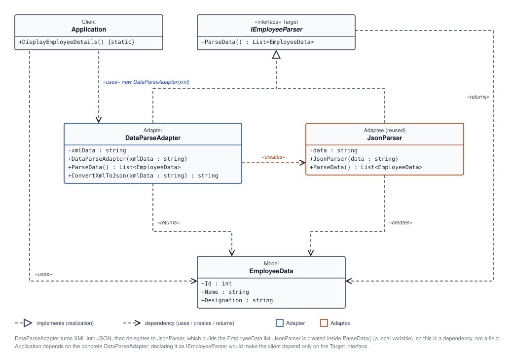

# 🔌 Adapter Pattern: Employee Data Parsing

## 🧩 What Is the Adapter Pattern?

The Adapter Pattern is a structural design pattern that lets two incompatible interfaces work together without changing their original implementations. It acts as a bridge between a client and an existing class or library, converting one interface into another expected by the client.

In simple terms, the adapter makes an existing component appear compatible with the code that wants to use it. This is especially useful when:

- the existing class is already working and should not be rewritten,
- the application expects one interface but the external source provides another,
- multiple data sources or formats need to be consumed through a common contract.

This project demonstrates the pattern by adapting XML employee data into the JSON-based parsing flow that the application expects.

## 🗂️ How This Example Works

This directory contains a small example that follows the Adapter Pattern to parse employee records from different data formats through a single interface.

### Core components

- `IEmployeeParser.cs`  
  Defines the common contract for all parsers.

  ```csharp
  public interface IEmployeeParser
  {
      List<EmployeeData> ParseData();
  }
  ```

  Any parser in the application must implement this interface, so the rest of the code can work with a standard method name and return type.

- `EmployeeData.cs`  
  Represents the final data model used by the application.

  ```csharp
  public class EmployeeData
  {
      public int Id { get; set; }
      public string Name { get; set; }
      public string Designation { get; set; }
  }
  ```

  This object is the normalized structure that the application wants to work with, regardless of the original source format.

- `JsonParser.cs`  
  Implements the `IEmployeeParser` interface and parses JSON data directly.

  The class accepts a JSON string, reads each array element using `System.Text.Json`, and converts every object into an `EmployeeData` instance.

  This is the adapter target or a compatible parser that already understands the application’s expected format.

- `DataParseAdapter.cs`  
  This is the key adapter class. It receives XML data, converts the XML into JSON, and then delegates the actual parsing to `JsonParser`.

  The flow is:

  ```text
  XML input -> DataParseAdapter -> ConvertXmlToJson() -> JsonParser -> EmployeeData list
  ```

  This means the client code does not need to understand XML parsing logic directly. It just asks the adapter for parsed employee records.

- `Application.cs`  
  Represents the client code. It creates XML data, wraps it in `DataParseAdapter`, and calls `ParseData()` as if the application were using a standard parser interface.

  The client code stays decoupled from source-format-specific details.

## 🔄 Why This Is Adapter Pattern

The application expects a parser that returns `List<EmployeeData>`. However, the actual source data arrives in XML, while the parsing implementation is built for JSON.

Instead of rewriting the whole application around XML, `DataParseAdapter` adapts the XML content into a JSON representation and then reuses the JSON parser. The result is a clean integration without changing the rest of the business logic.

This is exactly the purpose of the Adapter Pattern: it converts one interface into another so the existing system and the new source can work together smoothly.

## 🧭 UML Diagram



## ✅ Benefits

- 🔗 **Seamless integration:** existing classes can work with new systems through a common interface.
- ♻️ **Reusability:** the same parser logic can be reused even when data arrives in different formats.
- 🧠 **Simpler client code:** callers work with one consistent contract instead of dealing with format-specific logic.
- 🛠️ **Lower risk:** old code can remain stable while a new format is adapted around it.
- 📈 **Better maintainability:** data transformation logic stays in one adapter instead of spreading across the application.

## 🧭 Best Use Cases

Use the Adapter Pattern when:

- an application must consume data from multiple sources with different formats,
- an existing library or service needs to work with a new interface without major refactoring,
- multiple third-party APIs expose different contracts but must behave consistently in your application,
- old and new code need to interact while preserving compatibility,
- a system should support multiple input types while keeping business logic uniform.

This example is a strong fit because employee records can come from XML, JSON, CSV, or another source, yet the application wants a single `EmployeeData` model and the same parsing method.

## 🌍 Real-Life Examples

### 1. USB to HDMI adapters

A laptop may have only USB-C ports, while a monitor has an HDMI input. The adapter makes them connect without changing the laptop or monitor themselves.

### 2. Payment gateways

An e-commerce platform may support Stripe, PayPal, and Razorpay. Each payment provider exposes different APIs, but the application wants one consistent payment interface. An adapter converts each provider’s method signatures into the application’s required format.

### 3. Legacy systems and modern applications

A company might have a legacy database or file-based system, while the new application expects a modern API or object model. An adapter helps bridge the difference without rewriting the legacy system.

### 4. File and data import systems

A business application may need to import customer data from XML, JSON, Excel, or CSV files. Adapters normalize them into a single internal model before processing.

## 📌 Summary

The Adapter Pattern is about compatibility and flexibility. In this directory, XML employee data is adapted into the JSON-based parsing flow so the application can continue working with a common `IEmployeeParser` contract.

This pattern helps maintain clean architecture, reduces coupling, and keeps code easier to extend as new data sources and interfaces appear.
