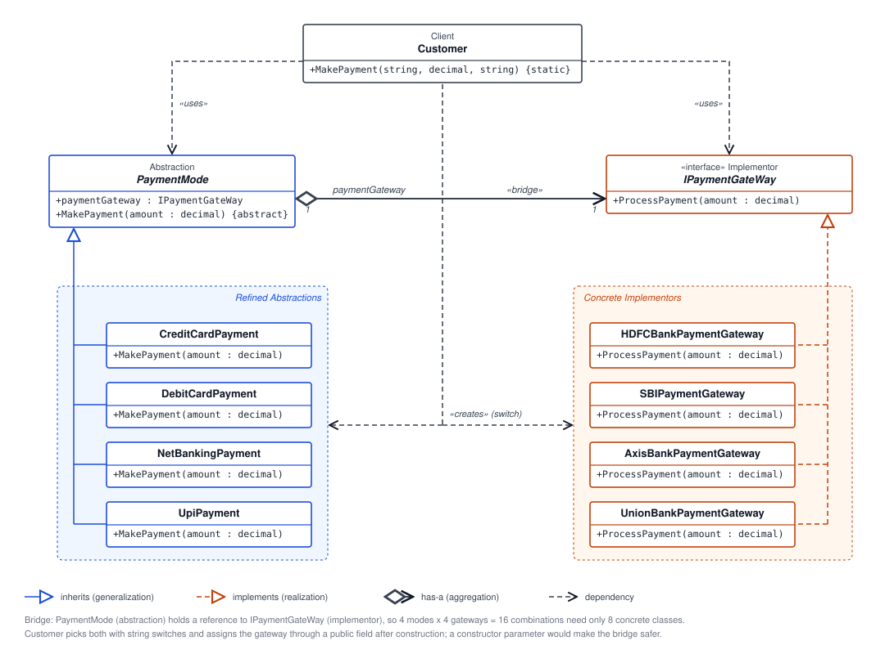

# Bridge Pattern: Payment Processing

## What Is the Bridge Pattern?

The Bridge Pattern is a structural design pattern that separates an abstraction from its implementation so both can vary independently. The abstraction defines the high-level behavior, while an implementation interface provides the lower-level operations it delegates to.

Instead of creating a separate class for every combination of two changing dimensions, each side can be extended independently and connected through composition.

## How This Example Works

This example separates **how a customer pays** from **which bank payment gateway processes the payment**.

- `PaymentMode` is the abstraction. It holds an `IPaymentGateWay` reference and defines `MakePayment`.
- `CreditCardPayment`, `DebitCardPayment`, `NetBankingPayment`, and `UpiPayment` are refined abstractions. Each handles its payment-mode-specific step, then delegates processing to the gateway.
- `IPaymentGateWay` is the implementation interface. It defines the `ProcessPayment` operation used by payment modes.
- `HDFCBankPaymentGateway`, `SBIPaymentGateway`, `AxisBankPaymentGateway`, and `UnionBankPaymentGateway` are concrete implementations of that interface.
- `Customer.MakePayment` chooses a payment mode and a gateway, connects them, and starts the payment.

For example, the customer can request a UPI payment through HDFC:

```csharp
Customer.MakePayment("HDFC", 250.00m, "UPI");
```

`Customer.MakePayment` creates a `UpiPayment` and an `HDFCBankPaymentGateway`, assigns the gateway to the payment mode, and calls `MakePayment`. The payment mode performs its own step and delegates the gateway processing through `IPaymentGateWay.ProcessPayment`.

The same payment mode can be paired with another bank gateway, and the same gateway can be used with another payment mode. This keeps payment-mode behavior separate from bank-specific processing.

## Real-Life Example

Consider a travel booking service that supports bookings for flights, hotels, and rental cars, while allowing customers to pay through different providers such as a bank gateway, a digital wallet, or a card processor. Booking type and payment provider are independent dimensions: the booking workflow can use any supported provider without implementing a separate booking class for every combination.

The Bridge Pattern models this by having each booking abstraction use a common payment-provider interface, with individual provider implementations handling their own processing.

## Best Use Cases

Use the Bridge Pattern when:

- an abstraction and its implementation need to evolve independently;
- a design has multiple independent dimensions, such as payment method and payment provider;
- adding a new option in one dimension should not require changes to every option in another;
- high-level behavior should delegate platform-, vendor-, or service-specific work through a stable interface;
- composition provides a clearer structure than a growing set of classes for every possible combination.

## UML Diagram



## Summary

The Bridge Pattern connects two independently extensible parts of a design through composition and an implementation interface. In this example, payment modes are separated from bank payment gateways, so either can be extended and combined without coupling every payment mode to every bank.
