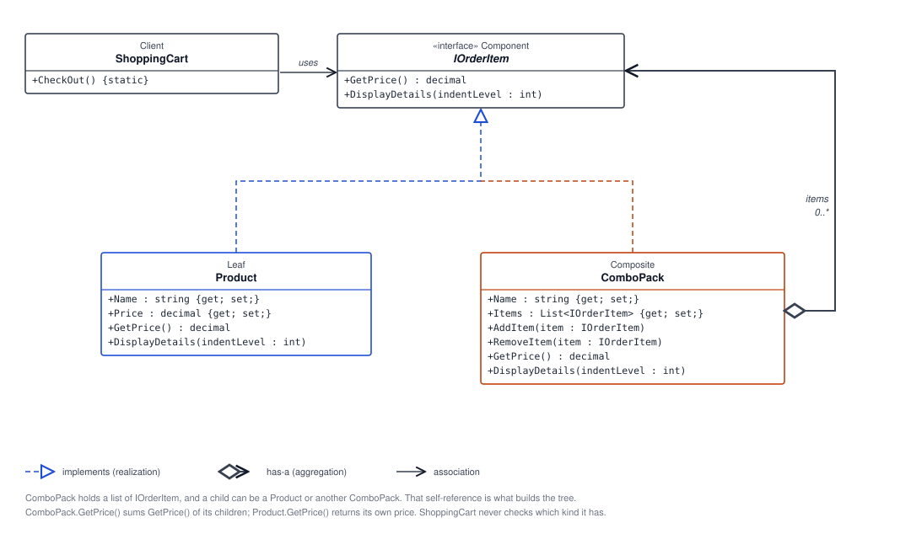

# 🧩 Composite Pattern: Shopping Cart Bundles

## 🌳 What Is the Composite Pattern?

The Composite Pattern is a structural design pattern that organizes individual objects and groups of objects into a tree-like structure. Both individual objects and groups share a common interface, allowing clients to use them in a consistent way without needing to distinguish between a single item and a collection.

In this example, an individual product and a combo pack both implement `IOrderItem`. A combo pack can therefore contain products as well as other combo packs.

## 🏗️ Code Structure

- **`IOrderItem` — Component:** Defines the shared operations, `GetPrice()` and `DisplayDetails(int indentLevel)`.
- **`Product` — Leaf:** Represents one product. Its `GetPrice()` returns its own price, and `DisplayDetails()` prints its name and price at the requested indentation level.
- **`ComboPack` — Composite:** Stores a list of `IOrderItem` objects. `AddItem()` and `RemoveItem()` manage its children; `GetPrice()` adds their prices together; and `DisplayDetails()` prints the pack and recursively displays each child.
- **`ShoppingCart` — Client:** Its `CheckOut()` method builds sample products and packs, nests the laptop combo inside the mobile combo, then displays the hierarchy and total.

The example's object hierarchy is:

```text
Mobile Combo
├── Samsung Galaxy S21
├── Samsung Galaxy S21 Charger
├── Samsung Earbuds
└── Laptop Combo
    ├── Lenovo ThinkPad
    ├── Lenovo ThinkPad Charger
    └── Lenovo Laptop Bag
```

When the outer combo's `GetPrice()` is called, it asks each child for its price. Products return their own prices, and the nested laptop combo returns the sum of its products. This recursive behavior lets the cart calculate and display totals using the same `IOrderItem` operations for leaves and composites.

## 📊 UML Diagram



## 🌍 Real-Life Example

A file system provides a familiar example of the Composite Pattern. A file is an individual item, while a folder is a container that can hold files and other folders. Both can be treated as file-system entries, so operations such as displaying a directory tree or calculating the total size can be applied recursively to either one.

Likewise, this shopping example treats a product as an individual order item and a combo pack as a group of order items.

## ✅ Benefits of the Composite Pattern

- **Uniform interaction:** Client code can work with individual products and nested packs through the same `IOrderItem` interface.
- **Natural tree structures:** Groups can contain individual objects and other groups.
- **Recursive operations:** Calculating totals and displaying details can follow the same logic through the hierarchy.
- **Easy extension:** New `IOrderItem` implementations can participate in the structure without changing the shared operations.
- **Clear separation of responsibilities:** Products handle their own price and display, while combo packs aggregate and delegate those operations to their children.

## 📝 Summary

The Composite Pattern represents individual objects and groups through a shared interface. Here, `Product` is the leaf and `ComboPack` is the composite; together they let `ShoppingCart` display and total nested order bundles through `IOrderItem`.
