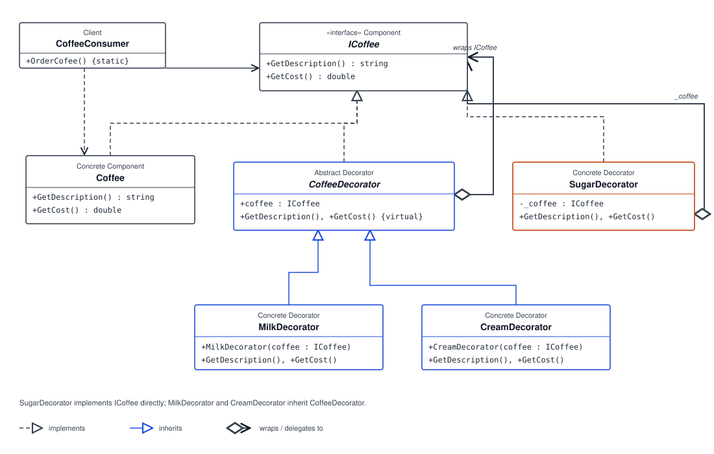

# ☕ Decorator Pattern: Custom Coffee Orders

## 🎨 What Is the Decorator Pattern?

The Decorator Pattern is a structural design pattern that adds responsibilities to an object by wrapping it in another object with the same interface. Each decorator can add behavior while forwarding existing operations to the object it wraps. Decorators can be combined in different orders to build a customized result at runtime.

In this example, coffee and each coffee add-on implement `ICoffee`. This lets the consumer use a plain coffee or a sequence of decorated coffees through the same `GetDescription()` and `GetCost()` operations.

## 🏗️ Code Structure

- **`ICoffee` — Component:** Defines the common `GetDescription()` and `GetCost()` operations.
- **`Coffee` — Concrete component:** Represents a plain coffee. It returns the description `"Coffee"` and a base cost of `100`.
- **`CoffeeDecorator` — Abstract decorator:** Implements `ICoffee` and holds a reference to another `ICoffee`. Its virtual methods delegate to the wrapped coffee.
- **`MilkDecorator` — Concrete decorator:** Wraps an `ICoffee`, appends `", Milk"` to its description, and adds `50` to its cost.
- **`CreamDecorator` — Concrete decorator:** Wraps an `ICoffee`, appends `", Cream"` to its description, and adds `70` to its cost.
- **`SugarDecorator` — Concrete decorator:** Implements `ICoffee` directly, wraps an `ICoffee`, appends `", Sugar"` to its description, and adds `10` to its cost.
- **`CoffeeConsumer` — Client:** Its `OrderCofee()` method starts with a plain coffee and successively wraps it with milk, cream, and sugar, displaying the description and cost after each addition.

The final order is built in layers:

```text
SugarDecorator(
    CreamDecorator(
        MilkDecorator(
            Coffee
        )
    )
)
```

Each wrapper delegates to the object inside it and adds its own description and price. The final description is `Coffee, Milk, Cream, Sugar`, and its cost is `100 + 50 + 70 + 10 = 230`.

## 📊 UML Diagram



## 🌍 Real-Life Example

A coffee shop lets customers customize a base drink with add-ons such as milk, cream, and sugar. Each choice contributes to the drink's description and price. Rather than creating a separate menu item for every possible combination, the order can be composed by wrapping the base coffee with the selected add-ons.

This mirrors the example: each add-on wraps an `ICoffee`, so the customer can combine options while the consumer continues to use the same interface.

## ✅ Benefits of the Decorator Pattern

- **Flexible combinations:** Add-ons can be selected and combined at runtime.
- **Composable behavior:** Multiple decorators can wrap one another to build layered behavior.
- **Consistent interface:** The client uses the same component operations for plain and decorated objects.
- **Focused responsibilities:** Each decorator contributes its own description and cost.
- **Extensibility:** Additional coffee options can be introduced as decorators without changing the base `Coffee` class.

## 📝 Summary

The Decorator Pattern adds behavior by wrapping an object with another object that implements the same interface. In this coffee example, `MilkDecorator`, `CreamDecorator`, and `SugarDecorator` build a custom drink by extending its description and cost while remaining usable as `ICoffee`.
