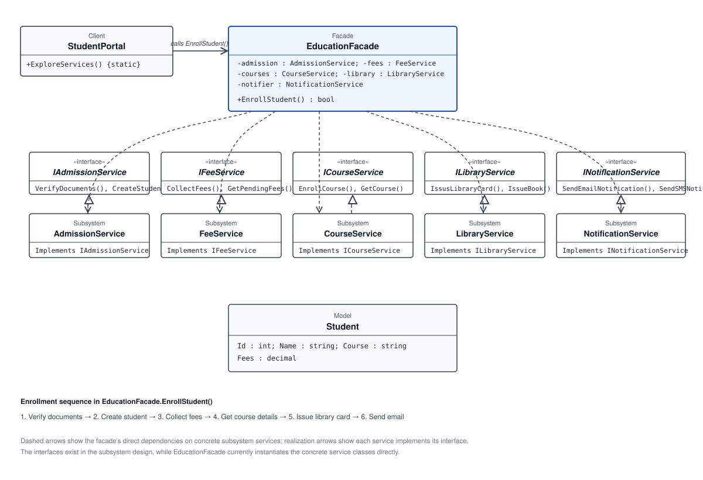

# 🏫 Facade Pattern: Education Enrollment

## 🎭 What Is the Facade Pattern?

The Facade Pattern is a structural design pattern that provides a simple, unified interface to a set of interfaces in a subsystem. It gives a client one convenient entry point for a workflow that would otherwise require the client to coordinate several subsystem services.

In this example, the education facade coordinates student admission, fee collection, course services, library services, and notifications behind one `EnrollStudent()` operation.

## 🏗️ Code Structure

- **`StudentPortal` — Client:** Calls `EducationFacade.EnrollStudent()` rather than coordinating the enrollment services itself.
- **`EducationFacade` — Facade:** Creates the subsystem services and controls their order of execution. It verifies documents, creates a student, collects fees, gets course details, issues a library card, and sends an email notification. It returns `false` if document verification or fee collection fails; otherwise it returns `true`.
- **`AdmissionService` — Subsystem service:** Verifies documents and creates a student. It implements `IAdmissionService`.
- **`FeeService` — Subsystem service:** Collects fees and provides pending-fee information. It implements `IFeeService`.
- **`CourseService` — Subsystem service:** Provides course operations, including enrollment and retrieving course details. It implements `ICourseService`.
- **`LibraryService` — Subsystem service:** Provides library-card and book-issuing operations. It implements `ILibraryService`.
- **`NotificationService` — Subsystem service:** Provides email and SMS notification operations. It implements `INotificationService`.
- **`Student` — Model:** Represents student information with an ID, name, course, and fees.
- **Service interfaces:** The `IAdmissionService`, `IFeeService`, `ICourseService`, `ILibraryService`, and `INotificationService` interfaces define contracts for their respective services.

The enrollment sequence in the facade is:

```text
Verify documents
    → Create student
    → Collect fees
    → Get course details
    → Issue library card
    → Send email notification
```

The client invokes only the facade method. The facade then coordinates the lower-level operations and reports whether the initial verification and fee-collection steps succeeded.

## 📊 UML Diagram



## 🌍 Real-Life Example

Booking a trip often involves separate services for flights, hotels, and car rentals. A travel-booking portal can offer a single “Book trip” operation that coordinates these systems and presents a simpler process to the traveler.

Similarly, `EducationFacade` offers a single enrollment operation while coordinating several education services on behalf of `StudentPortal`.

## ✅ Benefits of the Facade Pattern

- **Simpler client code:** A client uses a focused operation instead of calling and coordinating each subsystem service.
- **Centralized workflow:** The facade keeps the sequence of subsystem operations in one place.
- **Reduced coupling:** The client depends on the facade for the workflow rather than directly managing its individual steps.
- **Clear subsystem access:** A facade provides an approachable entry point while the underlying services retain their own responsibilities.
- **Easier use of complex subsystems:** A single operation can represent a multi-step process for common client needs.

## 📝 Summary

The Facade Pattern simplifies access to a group of services by providing a higher-level entry point. In this example, `EducationFacade.EnrollStudent()` coordinates the education subsystem services, allowing `StudentPortal` to start the enrollment workflow with one call.
