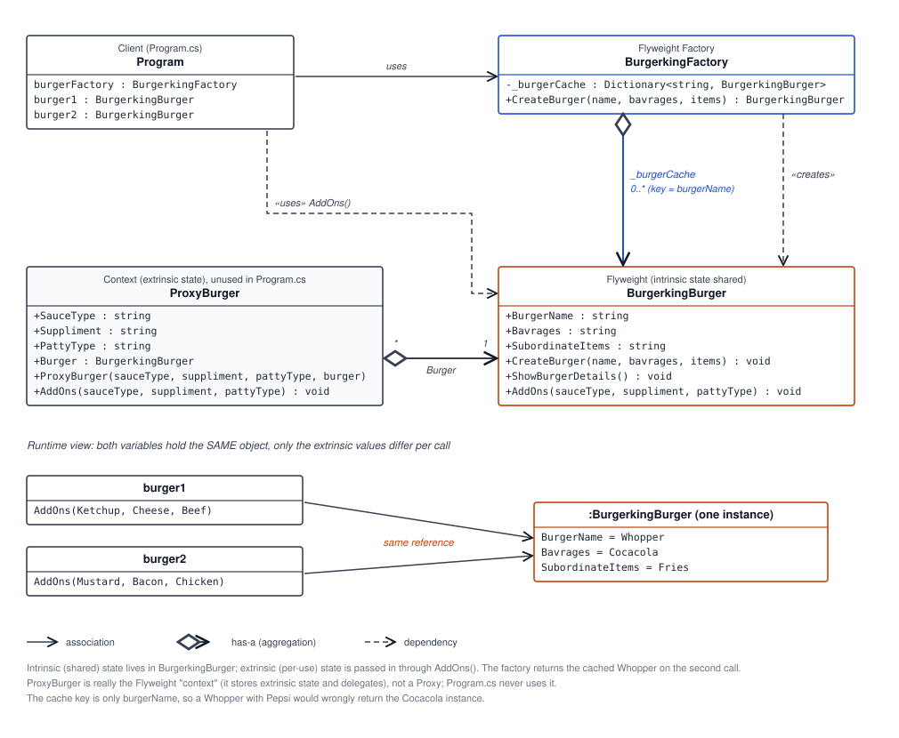

# 🍔 Flyweight Design Pattern

The **Flyweight** is a structural design pattern that reduces memory use when an application needs many similar objects. It keeps common, reusable data in shared objects and supplies changing, per-use data separately.

## 🧩 Core idea

Flyweight separates an object's state into:

- **Intrinsic state** — common data stored in and shared by a Flyweight.
- **Extrinsic state** — context-specific data passed in when the Flyweight is used.

A **Flyweight Factory** manages reusable instances. When a matching object is requested, the factory returns the cached instance instead of creating another one.

## 🗺️ UML diagram

## 💻 How this example works

The example models burger orders:

| Code element | Role |
| --- | --- |
| `BurgerkingFactory` | Flyweight Factory; stores `BurgerkingBurger` objects in `_burgerCache` and returns a cached object when its key is found. |
| `BurgerkingBurger` | Concrete Flyweight; holds the burger name, beverage, and side items, and displays its details. |
| `Program.cs` | Client; requests a Whopper twice and uses the returned objects with different add-ons. |
| `AddOns(...)` | Receives per-use details (sauce, supplement, and patty type) as parameters instead of storing them in the shared burger. |
| `ProxyBurger` | An additional wrapper that references a burger, but it is not used by the sample client. It behaves more like a context/delegating wrapper than a classic Proxy. |

In `Program.cs`, both calls request a Whopper with the same beverage and side items. The factory creates and caches the burger on the first request, then returns that same instance on the second. The calls to `AddOns` pass different details, so the shared burger can be used with different per-order data.

### ⚠️ Current example limitation

The cache is keyed only by `burgerName`. If the same name is requested with a different beverage or side, the factory still returns the first cached burger, ignoring the new values. The key should represent all intrinsic properties that distinguish a Flyweight, or the example should define those properties as canonical for each burger name.

The Flyweight's intrinsic properties are also publicly mutable. Mutating a cached object would affect every reference to that shared instance. In a production implementation, make intrinsic state immutable after construction.

## 🎯 Common use cases

- 🌳 Rendering large numbers of similar trees, particles, or game characters.
- 📝 Text editors storing glyph or character formatting data used repeatedly.
- 🗺️ Map applications displaying many markers or tiles with shared styling.
- 📦 Repeated product, icon, or UI definitions across a large catalog or screen.
- 🏙️ Simulation systems creating many entities that share configuration or visual data.

## ✅ Benefits

- 🧠 Reduces memory usage by sharing common object state.
- ♻️ Avoids repeated creation of equivalent objects.
- 📈 Can make applications with many similar objects more scalable.
- 🧱 Encourages a clear distinction between shared data and per-use context.

## 🌍 Real-world examples

- 🎮 **Games:** many tree or particle instances can share one model or texture while each has its own position and animation state.
- 🖋️ **Text rendering:** characters can share cached glyph shapes while each occurrence has its own position and styling context.
- 🗺️ **Maps:** repeated marker icons can share image data while each marker has its own coordinates and label.
- 🛍️ **Product catalogs:** products can share immutable descriptions or category data while each order line has its own quantity or customer-specific selections.

These are illustrative applications of the pattern; the exact shared and per-use data depends on the system.
