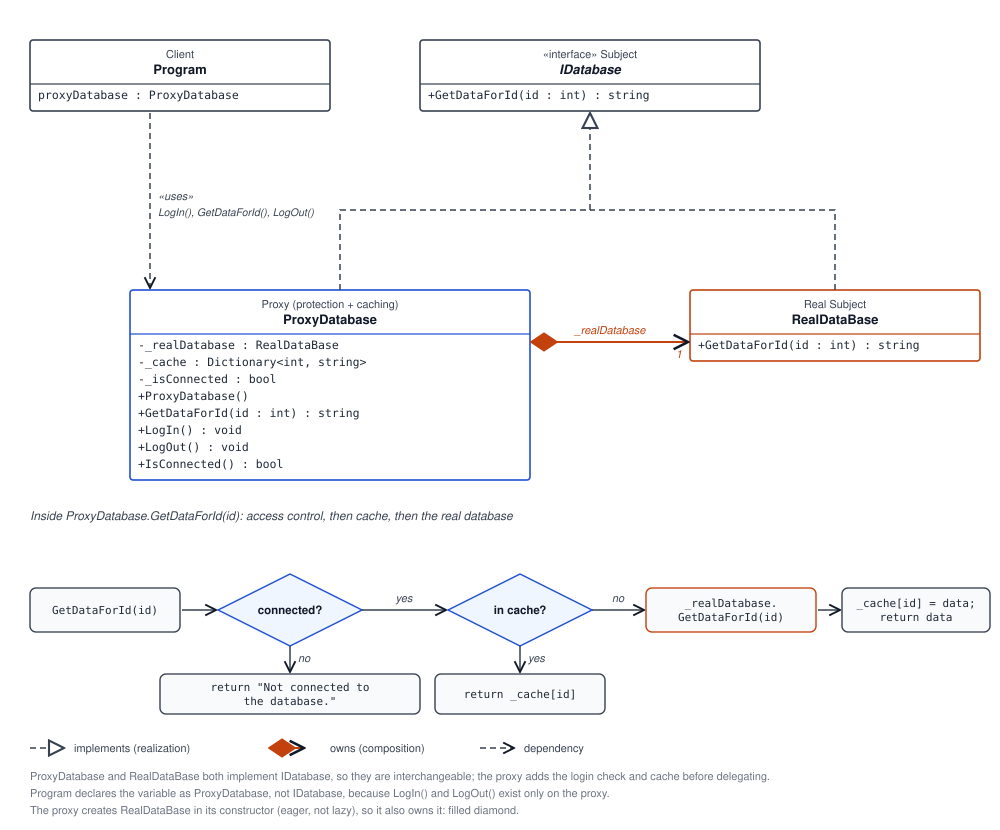

# 🛡️ Proxy Design Pattern

The **Proxy** is a structural design pattern that provides a substitute or intermediary for another object. The proxy implements the same interface as the real object, so a client can use the proxy in place of the real subject. The proxy can control access, defer work, cache results, log requests, or add other behavior before delegating to the real object.

## 🗺️ UML diagram

## 💻 How this example works

This example demonstrates a protection proxy with a simple in-memory cache:

| Code element | Role |
| --- | --- |
| `IDatabase` | Subject interface. Declares `GetDataForId(int id)`, the operation available through both the proxy and real subject. |
| `RealDataBase` | Real subject. Simulates retrieving a record by returning `"Data for ID: {id}"`. |
| `ProxyDatabase` | Proxy. Implements `IDatabase`, holds a `RealDataBase`, checks connection state, and caches results by ID. |
| `Program.cs` | Client. Creates the proxy, logs in, requests data, logs out, and requests data again. |

When `GetDataForId` is called, `ProxyDatabase` first checks whether the client is connected. If not, it returns `"Not connected to the database."` If connected, it checks the cache. A cache hit returns the saved result; a cache miss calls `RealDataBase`, stores the result, and returns it.

In the sample flow, the first request while logged in reaches the real subject. The later request occurs after logout and is denied—even though that ID has already been cached—because the proxy checks access before looking in the cache.

## 🎯 Common use cases

- 🔐 **Access control:** check permissions before allowing access to a service or resource.
- 💾 **Caching:** retain results from expensive operations and return them on later requests.
- ⏳ **Lazy initialization:** create a heavyweight object only when it is first needed.
- 🌐 **Remote proxy:** provide a local interface to an object in another process or on another machine.
- 📝 **Logging and monitoring:** record calls or measure usage while forwarding requests.
- 🧰 **Virtual proxy:** control access to large files, images, or other costly resources.

## ✅ Benefits

- 🚦 Controls access without requiring clients to know the real object's details.
- ♻️ Can avoid repeated expensive work with caching or lazy initialization.
- 🧱 Keeps cross-cutting behavior separate from the real subject.
- 🔄 Lets a proxy and real subject be used through the same interface.

## 🌍 Real-world examples

- 🖼️ An image viewer can use a virtual proxy to delay loading a large image until it is displayed.
- 🌐 An API client can use a remote proxy to make calls to a service running elsewhere.
- 🔐 A database or file-system proxy can verify the user's permissions before forwarding a request.
- 💾 A web service proxy can cache frequently requested data to reduce repeated backend work.
- 📊 A monitoring proxy can log calls and response times while delegating operations to the original service.

These are illustrative scenarios; the behavior a proxy adds depends on the application's requirements.

## ⚠️ Notes about this implementation

- `ProxyDatabase` currently creates its `RealDataBase` internally. Accepting an `IDatabase` dependency could make the proxy easier to test and allow different real-subject implementations.
- The cache is in-memory and remains populated across `LogOut()` and a later `LogIn()` on the same proxy instance. Logout blocks access while disconnected, but it does not clear cached entries.
- Connection state is a simple boolean for this demonstration, not production authentication or secure session management.
